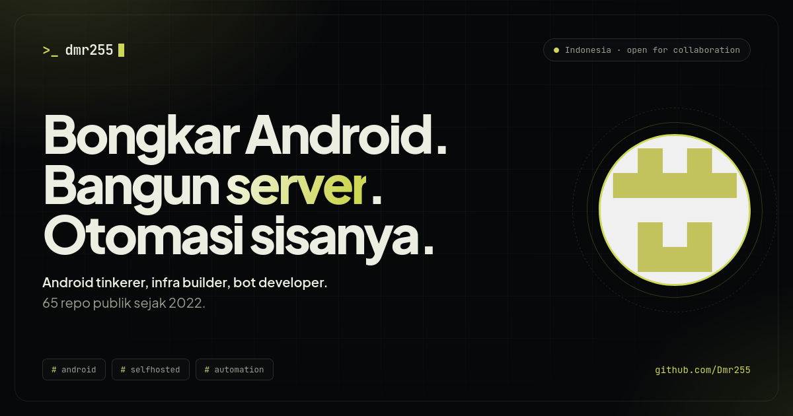

# dmr255.github.io

Situs portofolio [@Dmr255](https://github.com/Dmr255) — Android tinkerer, infra builder, bot developer.
Live di **https://dmr255.github.io/**

Dibangun tanpa framework: HTML + CSS + JS vanilla, data repo diambil langsung dari GitHub API
(dengan fallback statis kalau API kena rate limit).



## Struktur

```
index.html              halaman utama
404.html                halaman error
assets/                 styles.css, app.js, avatar, favicon
og-image.png            preview sosial 1200×630
tools/og.html           sumber OG image (screenshot 1200×630)
robots.txt · sitemap.xml · site.webmanifest · .nojekyll
```

## Jalankan lokal

```bash
python3 -m http.server 8000
# buka http://localhost:8000
```

## Deploy

Repo ini adalah **user site** (`Dmr255.github.io`), jadi isi branch `main` langsung
dipublikasikan GitHub Pages ke root domain `https://dmr255.github.io/`.
Tidak perlu workflow Actions — cukup push ke `main`.

> Kalau suatu saat pindah ke source “GitHub Actions”:
> Settings → Pages → Source: GitHub Actions, lalu tambahkan workflow Pages.

## Versi lama

Situs **Ultra Scanner v7.0** sebelumnya disimpan di branch
[`archive/ultra-scanner-v7`](../../tree/archive/ultra-scanner-v7),
lengkap dengan `server.js`. Scanner itu memanggil endpoint `/api/scan` (butuh backend),
jadi tidak ikut berjalan di GitHub Pages.

## Update konten

| Mau ubah | Di mana |
|---|---|
| Teks hero, tentang, skill, kontak | `index.html` |
| Repo pilihan & deskripsi cadangan | `FEATURED`, `NOTES` di `assets/app.js` |
| Kategori repo | `CATEGORY` di `assets/app.js` |
| Warna & tema | variabel CSS di `assets/styles.css` |
| OG image | edit `tools/og.html`, lalu screenshot 1200×630 |

Regenerate OG image:

```bash
firefox --headless --window-size=1200,630 \
  --screenshot og-image.png "file://$PWD/tools/og.html"
```

## Lisensi

MIT © 2026 Dmr255
